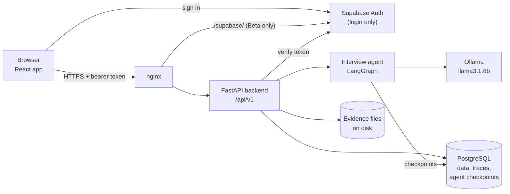

# Architecture and technical overview

How the Agentic GRC prototype is built after the Beta, for a developer who joins the project. It
explains the parts of the system, how a request flows through them, and how login, organization
isolation and roles work. Details that already have their own document are linked, not repeated.

| Topic | Document |
|---|---|
| Run the backend locally, environment variables | [`backend/README.md`](../backend/README.md) |
| Run the frontend locally, build under a sub-path | [`frontend/README.md`](../frontend/README.md) |
| Interview agent: graph, rules, fallbacks | [`backend/app/agent/README.md`](../backend/app/agent/README.md) |
| Local Ollama setup and model benchmarks | [`ollama-setup.md`](ollama-setup.md) |
| Install on the university VMs | [`deployment-vm.md`](deployment-vm.md) |
| Operate the VMs: logs, restarts, backups, recovery | [`runbook-vm.md`](runbook-vm.md) |
| Decisions: framework scope, agent and LLM, data governance | [`decisions/`](decisions/) |
| Reasoning trace schema, agent–backend contract | [`design/`](design/) |
| Acceptance tests traced to user stories | [`testing/acceptance-tests.md`](testing/acceptance-tests.md) |

## 1. System overview

A consultant from Aligo creates an assessment for a client organization. A representative of that
organization answers a conversational interview and uploads the evidence the agent asks for. The
agent proposes a status for each in-scope NIST CSF 2.0 control; the consultant accepts, modifies
or rejects each proposal; the report and the gap list are built from the confirmed results.

On the Beta the request path is: university proxy → nginx `:80` → API `127.0.0.1:8000` → Ollama
`127.0.0.1:11434` on the same VM, and PostgreSQL on the database VM. Section 6 has the deployment.

## 2. Frontend

- **Stack:** React 19 and Vite, plain JavaScript (no TypeScript). Tests use Vitest and Testing
  Library.
- **Structure:** `frontend/src/App.jsx` holds the navigation rail and switches between the
  workspaces in `frontend/src/features/`: `organizations`, `assessments`, `interviews`,
  `expertReviews` and `reports`. Each feature has its own `api.js` for its backend calls.
- **Login:** the Supabase JS client in `frontend/src/auth/` signs the user in (email and password,
  optionally Google) and keeps the session in the browser tab. Every API call sends the Supabase
  access token as a bearer token.
- **Navigation by role:** the rail hides Client onboarding and Expert reviews for a representative.
  This is only for usability; the backend enforces the rules (section 5).
- **Base path:** built with `VITE_BASE_PATH=/agentic-grc/` for the Beta, so assets, routes and the
  API base follow the sub-path ([`frontend/README.md`](../frontend/README.md)).

## 3. Backend

- **Stack:** Python 3.13 (the CI version), FastAPI, SQLAlchemy 2, Alembic, psycopg 3, Pydantic,
  LangGraph, ReportLab for the PDF report.
- **Structure** (`backend/app/`):

  | Folder | Contents |
  |---|---|
  | `api/v1/endpoints/` | HTTP routes, one module per area |
  | `services/` | Business logic: assessments, interviews, expert reviews, reports, gaps, risk classification |
  | `agent/` | The interview agent ([README](../backend/app/agent/README.md)) |
  | `security/` | Token verification, identity mirror, review access checks |
  | `db/` | SQLAlchemy models and the database session |
  | `core/` | Settings read from the environment |

- **API areas** (all under `/api/v1`):

  | Area | Routes |
  |---|---|
  | Account | `GET /auth/me`, `POST /auth/accept-invitation` |
  | Organizations and invitations | `/organizations`, `/organizations/{org}`, `/organizations/{org}/invitations`, `/organizations/me/invitations` |
  | Assessments | `/organizations/{org}/assessments`, `.../{assessment}`, `.../scope`, `.../controls` |
  | Interview | `.../{assessment}/interview`, `.../interview/status`, `.../interview/turns` |
  | Evidence | `/evidence/` (upload, list), `/evidence/links`, `/evidence/{id}/controls` |
  | Expert review | `/expert-reviews/pending`, `/expert-reviews/{result}/trace`, `.../evidence`, `.../decision` |
  | Reasoning traces | `.../{assessment}/traces`, `.../traces/export` |
  | Report and gaps | `.../{assessment}/report`, `.../report.pdf`, `.../report.json`, `.../gaps` |
  | Other | `/health`, `/reference-data/industry-sectors`, `/reference-data/organization-sizes` |

  The interactive API documentation is at `/docs` when the backend runs.

## 4. Interview agent and data

- **The model interprets, code decides.** The agent is a LangGraph state machine. The model
  (Ollama, `llama3.1:8b`) turns a free-text answer into structured fields and words the follow-up
  questions; Python rules in `agent/rules.py` choose the next step and the control status. If the
  model fails or times out, keyword fallbacks keep the interview going and the result goes to human
  review. Details and reasons: [agent README](../backend/app/agent/README.md),
  [ADR 0002](decisions/0002-agent-architecture-llm-data-policy.md).
- **Pause and resume:** the agent's state is saved by the LangGraph Postgres checkpointer, one thread
  per interview session, in the `agentic_grc_private` schema. An interview can stop and continue
  later.
- **Human in the loop:** every result the agent writes is a draft. It reaches the report only after
  a consultant accepts or modifies it in Expert review.
- **Explainability:** each decision of the agent and each review is stored as a reasoning trace
  ([trace schema](design/trace-schema.md)). Traces, results and reviews are append-only: database
  triggers reject `UPDATE`, `DELETE` and `TRUNCATE` on `decision_traces`, `decision_trace_sources`,
  `control_results` and `control_result_reviews`. A change is a new version, never an edit.
- **Database:** PostgreSQL. During development it is a Supabase project; on the Beta it is
  PostgreSQL 18 on the database VM. The schema is managed by Alembic (`backend/migrations/`).
- **Evidence files:** stored on the backend host's disk (on the Beta in
  `/var/lib/agentic-grc/uploaded_evidence`); the database keeps their metadata and their links to
  controls. Allowed types: PDF, TXT, DOCX, CSV, XLSX.
- **Data allowed:** `INTERVIEW_DATA_MODE` is `synthetic` by default. Real organizational data is
  blocked until the approvals in [ADR 0003](decisions/0003-interview-data-governance.md) are in
  place.

## 5. Authentication, organization isolation and roles

### Login

Supabase Auth is the identity provider; the backend issues no tokens of its own.

1. The browser signs in with Supabase and gets an access token.
2. Each API request carries the token. The backend checks it with Supabase's user endpoint
   (`/auth/v1/user`) and loads the matching application user (`public.users`). An invalid token
   returns 401.
3. Public sign-up is off. A new user joins through an invitation: an organization administrator
   invites by email, the link is single-use, stored only as a SHA-256 hash and valid for seven
   days ([`backend/README.md`](../backend/README.md#organizations-and-invitations)).

On the Beta two things differ ([`deployment-vm.md`](deployment-vm.md)):

- The university proxy only allows the browser to call its own origin, so nginx forwards
  `/agentic-grc/supabase/` to Supabase.
- The database is not a Supabase project, so `auth.users` is a stand-in table. With
  `AUTH_MIRROR_LOCAL_IDENTITIES=true` the backend writes a minimal row there for a user Supabase has
  already verified (`backend/app/security/local_identity.py`). The row grants nothing: memberships,
  roles and admin rights are still checked in `public`.

### Roles

| Role | Where it is stored | Meaning |
|---|---|---|
| Platform administrator | `users.is_platform_admin` | Operates the platform; can see every organization |
| Administrator | `organization_memberships.role` | Manages one organization and invites its members |
| Consultant | `organization_memberships.role` | Aligo consultant: runs assessments and reviews the agent's results |
| Representative | `organization_memberships.role` | Person at the assessed organization: answers the interview and provides evidence |

A membership is `active` or `suspended`; a suspended membership counts as no membership.

### What each role can do

| Action | Consultant / administrator | Representative | No active membership in the organization |
|---|---|---|---|
| Create an assessment | Yes | No (403) | No (404) |
| Open, read and answer the interview | Yes | Yes | No (404) |
| Upload evidence, list evidence and links | Yes | Yes | No (403) |
| Expert review: queue, decision, review evidence | Yes | No (403, not in the queue) | No (404, not in the queue) |
| Reasoning traces and trace export | Yes | No (403) | No (404) |
| Report (preview, PDF, JSON) and gap list | Yes | Yes | No (404) |
| Invite members, edit the organization | Administrator only | No | No |

A platform administrator passes these checks without a membership, with one exception: uploading
and listing evidence needs an active membership, as for everyone else.

### How isolation is enforced

- **In the API, on every request.** Each route looks up the caller's active membership in the
  organization the resource belongs to and, where needed, checks the role. An assessment, result or
  trace of another organization is not returned even when its id is known, including when it is
  put under the caller's own organization in the URL.
- **404 instead of 403 for outsiders.** A user with no membership gets the same answer as for an
  organization or assessment that does not exist, so nothing about it leaks. A member with the
  wrong role gets 403. The evidence routes are the exception: they answer outsiders with 403.
- **In the database, for references.** Composite foreign keys tie rows to their organization: for
  example, a trace can only point to an assessment, or to another trace, of the same organization
  and assessment.
- **Row-level security** is enabled on the application tables with no policies. It does not
  implement the isolation above; that is done by the API.

The rules are verified by `backend/tests/test_cross_organization_api.py` and the HU-02/HU-03
acceptance tests, listed with their results in
[`testing/acceptance-tests.md`](testing/acceptance-tests.md#hu-02--hu-03--organization-isolation-and-role-permissions).

## 6. Deployment

The Beta runs on two university VMs, reached through a bastion:

| VM | Runs |
|---|---|
| `agentic-grc` (app, Tesla M10 GPU) | nginx, the FastAPI backend and Ollama, as systemd services |
| `db-agentic-grc` (database) | PostgreSQL 18 and a nightly `pg_dump` |

Public URL: <https://gita.udea.edu.co/agentic-grc/>. Installation is in
[`deployment-vm.md`](deployment-vm.md); operation, backups and recovery are in
[`runbook-vm.md`](runbook-vm.md). Secrets stay in `/etc/agentic-grc/backend.env` on the app VM and
are never committed.
