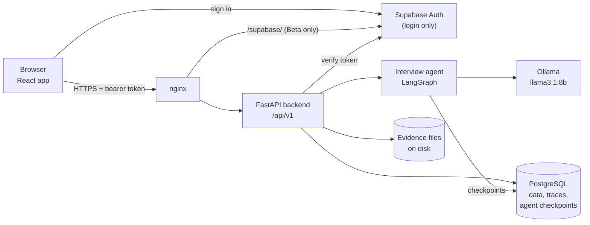

# Architecture and technical overview

How the Agentic GRC prototype is built after the Beta, for a developer who joins the project. It
explains the parts of the system, how a request flows through them, and how login, organization
isolation and roles work, what the data model and the JSON export look like, and how to add a
framework or knowledge-base version. Details that already have their own document are linked, not repeated.

| Topic | Document |
|---|---|
| Run the backend locally, environment variables | [`backend/README.md`](../backend/README.md) |
| Run the frontend locally, build under a sub-path | [`frontend/README.md`](../frontend/README.md) |
| Interview agent: graph, rules, fallbacks | [`backend/app/agent/README.md`](../backend/app/agent/README.md) |
| Local Ollama setup and model benchmarks | [`ollama-setup.md`](ollama-setup.md) |
| Install on the university VMs | [`deployment-vm.md`](deployment-vm.md) |
| Operate the VMs: logs, restarts, backups, recovery | [`runbook-vm.md`](runbook-vm.md) |
| Decisions: framework scope, agent and LLM, data governance | [`decisions/`](decisions/) |
| Reasoning trace schema, agent–backend contract, passage matching | [`design/`](design/) |
| Acceptance tests traced to user stories | [`testing/acceptance-tests.md`](testing/acceptance-tests.md) |
| Code style and formatting rules | [`coding-standards.md`](coding-standards.md) |

## 1. System overview

A consultant from Aligo creates an assessment for a client organization. A representative of that
organization answers a conversational interview and uploads the evidence the agent asks for. The
agent proposes a status for each in-scope NIST CSF 2.0 control; the consultant accepts, modifies
or rejects each proposal; the report and the gap list are built from the confirmed results.



On the Beta the request path is: university proxy → nginx `:80` → API `127.0.0.1:8000` → Ollama
`127.0.0.1:11434` on the same VM, and PostgreSQL on the database VM. Section 9 has the deployment.

## 2. Frontend

- **Stack:** React 19 and Vite, plain JavaScript (no TypeScript). Tests use Vitest and Testing
  Library.
- **Structure:** `frontend/src/App.jsx` holds the navigation rail and switches between the
  workspaces in `frontend/src/features/`: `organizations`, `assessments`, `interviews`,
  `expertReviews` and `reports`. Each feature has its own `api.js` for its backend calls.
- **Login:** the Supabase JS client in `frontend/src/auth/` signs the user in (email and password,
  optionally Google) and keeps the session in the browser tab. Every API call sends the Supabase
  access token as a bearer token.
- **Navigation by role:** the rail hides Client onboarding and Expert reviews for a representative.
  This is only for usability; the backend enforces the rules (section 8).
- **Base path:** built with `VITE_BASE_PATH=/agentic-grc/` for the Beta, so assets, routes and the
  API base follow the sub-path ([`frontend/README.md`](../frontend/README.md)).

## 3. Backend

- **Stack:** Python 3.13 (the CI version), FastAPI, SQLAlchemy 2, Alembic, psycopg 3, Pydantic,
  LangGraph, ReportLab for the PDF report.
- **Structure** (`backend/app/`):

  | Folder | Contents |
  |---|---|
  | `api/v1/endpoints/` | HTTP routes, one module per area |
  | `services/` | Business logic: assessments, interviews, expert reviews, reports, gaps, risk classification |
  | `agent/` | The interview agent ([README](../backend/app/agent/README.md)) |
  | `security/` | Token verification, identity mirror, review access checks |
  | `db/` | SQLAlchemy models and the database session |
  | `core/` | Settings read from the environment |

- **API areas** (all under `/api/v1`):

  | Area | Routes |
  |---|---|
  | Account | `GET /auth/me`, `POST /auth/accept-invitation` |
  | Organizations and invitations | `/organizations`, `/organizations/{org}`, `/organizations/{org}/invitations`, `/organizations/me/invitations` |
  | Assessments | `/organizations/{org}/assessments`, `.../{assessment}`, `.../scope`, `.../controls` |
  | Interview | `.../{assessment}/interview`, `.../interview/status`, `.../interview/turns` |
  | Evidence | `/evidence/` (upload, list), `/evidence/links`, `/evidence/{id}/controls` |
  | Expert review | `/expert-reviews/pending`, `/expert-reviews/{result}/trace`, `.../evidence`, `.../decision` |
  | Reasoning traces | `.../{assessment}/traces`, `.../traces/export` |
  | Report and gaps | `.../{assessment}/report`, `.../report.pdf`, `.../report.json`, `.../gaps` |
  | Document passages | `.../{assessment}/passage-matches` |
  | Other | `/health`, `/reference-data/industry-sectors`, `/reference-data/organization-sizes` |

  The interactive API documentation is at `/docs` when the backend runs.

## 4. Interview agent and data

- **The model interprets, code decides.** The agent is a LangGraph state machine. The model
  (Ollama, `llama3.1:8b`) turns a free-text answer into structured fields and words the follow-up
  questions; Python rules in `agent/rules.py` choose the next step and the control status. If the
  model fails or times out, keyword fallbacks keep the interview going and the result goes to human
  review. Details and reasons: [agent README](../backend/app/agent/README.md),
  [ADR 0002](decisions/0002-agent-architecture-llm-data-policy.md).
- **Pause and resume:** the agent's state is saved by the LangGraph Postgres checkpointer, one thread
  per interview session, in the `agentic_grc_private` schema. An interview can stop and continue
  later.
- **Human in the loop:** every result the agent writes is a draft. It reaches the report only after
  a consultant accepts or modifies it in Expert review.
- **Explainability:** each decision of the agent and each review is stored as a reasoning trace
  ([trace schema](design/trace-schema.md)). Traces, results and reviews are append-only: database
  triggers reject `UPDATE`, `DELETE` and `TRUNCATE` on `decision_traces`, `decision_trace_sources`,
  `control_results` and `control_result_reviews`. A change is a new version, never an edit.
- **Database:** PostgreSQL. During development it is a Supabase project; on the Beta it is
  PostgreSQL 18 on the database VM. The schema is managed by Alembic (`backend/migrations/`).
- **Evidence files:** stored on the backend host's disk (on the Beta in
  `/var/lib/agentic-grc/uploaded_evidence`); the database keeps their metadata and their links to
  controls. Allowed types: PDF, TXT, DOCX, CSV, XLSX.
- **Document passages:** the text of each file is extracted on upload (PDF pages are kept apart).
  When a consultant opens Expert review, the passages that mention an in-scope control are proposed
  next to it, with the file, page or section and the matched terms. Matching is lexical, computed when
  it is read and never stored; a proposed passage is always marked `not_verified`
  ([design](design/hu12-passage-matching.md)).
- **Data allowed:** `INTERVIEW_DATA_MODE` is `synthetic` by default. Real organizational data is
  blocked until the approvals in [ADR 0003](decisions/0003-interview-data-governance.md) are in
  place.

## 5. Data model

All tables are defined in `backend/app/db/models.py` (24 tables) and created by the Alembic
migrations in `backend/migrations/versions/`. Every table that holds an organization's data (all except
`users`, the reference lists and the knowledge-base tables) has an `organization_id` column, which is what the isolation checks in section 8 filter on.

| Group | Tables | What they hold |
|---|---|---|
| Users and organizations | `users`, `organizations`, `organization_memberships`, `organization_invitations`, `industry_sectors`, `organization_sizes` | Local user rows (the `id` is the Supabase account id), organizations, one membership (role and status) per user and organization, invitations, and the reference lists for sector and size |
| Knowledge base | `frameworks`, `framework_versions`, `kb_versions`, `interview_blocks`, `assessment_modules`, `questions` | Questions grouped into modules and blocks, under a KB version of a framework version. A KB version is `draft`, `published` or `retired`; only a published one is used for interviews |
| Interview | `assessments`, `assessment_participants`, `assessment_sessions`, `session_participants`, `interview_turns` | An assessment (framework, framework version and KB version are stored on it), who takes part, interview sessions and each question–answer turn |
| Results | `assessment_controls`, `control_results`, `control_result_reviews` | The controls in scope of an assessment; versioned results per control (`version_no`, `based_on_result_id`, `author_actor` = `agent` or `aligo_consultant`, status, explanation, evidence references); review outcomes (`accepted`, `modified`, `rejected`) |
| Evidence | `evidence_files`, `evidence_control_links` | Metadata and extracted text of uploaded files (the file itself is on disk), and which file is linked to which control |
| Traces | `decision_traces`, `decision_trace_sources` | The reasoning trace of each agent decision and each review, and the sources it used |

A result is never edited. The agent writes a result; a consultant's modification is a new version
that points to the one it replaces (`based_on_result_id`), and the review row records which version
the review produced (`resulting_result_id`). In the report, the version with the highest
`version_no` decides the state of each control. The tables
`control_results`, `control_result_reviews`, `decision_traces` and `decision_trace_sources` are
append-only (section 4).

The LangGraph checkpoints of paused interviews are not in these tables. The checkpointer keeps them
in its own tables in the `agentic_grc_private` schema.

## 6. Report and JSON export format

The report has three endpoints under `/api/v1/organizations/{organization}/assessments/{assessment}`:

| Endpoint | Returns |
|---|---|
| `GET .../report` | The report preview shown in the app: the report plus the gap list |
| `GET .../report.pdf` | The PDF, as `agentic-grc-report-{assessment_id}.pdf` |
| `GET .../report.json` | The structured export, as `agentic-grc-report-{assessment_id}.json` |

The PDF and the JSON have the same content as the preview, without the gap list. The JSON schema is
defined by the Pydantic models in `backend/app/schemas/report.py`:

```text
ReportExport
├─ export_format: "agentic-grc.assessment-report"
├─ export_version: "1.1"            (1.1 added results[].linked_evidence)
└─ report: ReportView
   ├─ organization: id, name, sector, size
   ├─ assessment: id, title, framework ("NIST CSF 2.0"), kb_version, status,
   │              started_at, completed_at
   ├─ generated_at, is_demo_data
   ├─ scope[]: code, title                         (sorted by code)
   ├─ results[]: FinalResult                       (sorted by code)
   │   code, title, control_status, status_label, basis, reviewed_by, reviewed_at,
   │   explanation, not_assessed_reason, evidence_pending,
   │   evidence[]: source_type, reference, excerpt, nature
   │   linked_evidence[]: id, file_name, file_type, size_bytes, sha256, uploaded_at, linked_at
   ├─ pending[]: code, title, reason, reason_label (sorted by code)
   ├─ exclusions[]: code, title, justification, reviewed_by, reviewed_at
   └─ summary: controls_in_scope, finalized, pending, final_with_evidence_pending,
               coverage_pct, status_counts
```

Allowed values:

- `control_status`: `implemented`, `partially_implemented`, `not_implemented`, `not_assessed`,
  `not_applicable`. A control marked `not_applicable` in review is listed under `exclusions`, not
  `results`.
- `basis`: `accepted_agent_result` (the consultant accepted the agent's result) or
  `consultant_version` (the consultant wrote a new version).
- `pending[].reason`: `awaiting_review`, `rejected_awaiting_new_version`,
  `modified_awaiting_consultant_version`, `no_result`.
- `evidence[].source_type`: `interview_turn`, `document_span`, `tenant_configuration`,
  `prior_phase_evidence`; `evidence[].nature`: `intent`, `implementation`, `attestation`.
- `summary.coverage_pct` is finalized controls divided by controls in scope, times 100, rounded to
  one decimal. `summary.status_counts` always has the keys `implemented`, `partially_implemented`,
  `not_implemented` and `not_assessed`.

Only reviewed results reach the report; drafts never do. Linked files appear with their metadata
and SHA-256 hash, never with their extracted text. Version 1.1 added `results[].linked_evidence`; a change that removes or renames a field should
raise `export_version` again.

## 7. Adding a framework or a knowledge-base version

The database can hold several frameworks and KB versions (section 5), but today the application
supports one: NIST CSF 2.0 with the demo KB version `demo-0.2`. Adding a new one is a code change,
not only a data change. These are the places to touch:

1. **Questions.** Write the KB file in the format of `backend/app/agent/data/kb_demo.yaml`:
   `kb_version`, `language_code`, and per question a `code`, `module`, `text`, `intent`,
   `detail_needed`, `clarification`, `evidence_examples` and `mappings` (`node_code`, `justification`,
   `confidence`). The agent reads one file, set by `AGRC_KB_PATH`, and refuses an interview whose
   `kb_version` differs from the file's, or whose language is not `en`.
2. **Questions in the database.** If the KB version exists in `kb_versions` with its modules and
   questions, the interview uses those rows, matched to the YAML by question `code`. The repository
   has no script that loads a KB into these tables; they have to be filled by hand or by a new
   script. Without rows, the interview falls back to the YAML questions, which is allowed only in
   `synthetic` data mode.
3. **Controls in scope.** Add the version and its control codes to `KB_SCOPES` in
   `backend/app/services/assessment_scope.py`, and any missing code to `CSF_SUBCATEGORY_TITLES`,
   `CSF_CATEGORIES` or `CSF_FUNCTIONS` there. `KB_SCOPES` also decides which values of `kb_version`
   the API accepts when an assessment is started. `DEFAULT_KB_VERSION` is in
   `backend/app/schemas/assessments.py`.
4. **Per-control tables.** Each control needs an entry in three tables keyed by control code:
   `CONTROL_TERMS` in `services/passage_matching.py` (passage matching, HU-12),
   `CONTROL_RULES` in `services/risk_classification.py` (risk priority, HU-17) and
   `REMEDIATION_TEMPLATES` in `services/remediation.py` (recommendations, HU-18). A control without
   an entry still works in the interview and the report, but it gets no proposed passages, its gaps
   are listed as unclassified, and it gets no recommendation.
5. **A framework other than NIST CSF 2.0.** `start_assessment` in `services/assessments.py` stores
   `framework_code="NIST-CSF"` and `framework_version="2.0"` for every assessment, and the report
   model has `"NIST CSF 2.0"` as the framework name. Both have to change, together with the
   function and category titles in `assessment_scope.py`.
6. **Tests.** Add tests for the new scope and rules next to the existing ones in `backend/tests/`,
   and run the full suite (section 10).

The real knowledge base (backlog item E0-03) is expected to replace the demo KB; moving the
per-control tables and the framework name into the database would turn steps 3–5 into data changes.

## 8. Authentication, organization isolation and roles

### Login

Supabase Auth is the identity provider; the backend issues no tokens of its own.

1. The browser signs in with Supabase and gets an access token.
2. Each API request carries the token. The backend checks it with Supabase's user endpoint
   (`/auth/v1/user`) and loads the matching application user (`public.users`). An invalid token
   returns 401.
3. Public sign-up is off. A new user joins through an invitation: an organization administrator
   invites by email, the link is single-use, stored only as a SHA-256 hash and valid for seven
   days ([`backend/README.md`](../backend/README.md#organizations-and-invitations)).

On the Beta two things differ ([`deployment-vm.md`](deployment-vm.md)):

- The university proxy only allows the browser to call its own origin, so nginx forwards
  `/agentic-grc/supabase/` to Supabase.
- The database is not a Supabase project, so `auth.users` is a stand-in table. With
  `AUTH_MIRROR_LOCAL_IDENTITIES=true` the backend writes a minimal row there for a user Supabase has
  already verified (`backend/app/security/local_identity.py`). The row grants nothing: memberships,
  roles and admin rights are still checked in `public`.

### Roles

| Role | Where it is stored | Meaning |
|---|---|---|
| Platform administrator | `users.is_platform_admin` | Operates the platform; can see every organization |
| Administrator | `organization_memberships.role` | Manages one organization and invites its members |
| Consultant | `organization_memberships.role` | Aligo consultant: runs assessments and reviews the agent's results |
| Representative | `organization_memberships.role` | Person at the assessed organization: answers the interview and provides evidence |

A membership is `active` or `suspended`; a suspended membership counts as no membership.

### What each role can do

| Action | Consultant / administrator | Representative | No active membership in the organization |
|---|---|---|---|
| Create an assessment | Yes | No (403) | No (404) |
| Open, read and answer the interview | Yes | Yes | No (404) |
| Upload evidence, list evidence and links | Yes | Yes | No (403) |
| Expert review: queue, decision, review evidence | Yes | No (403, not in the queue) | No (404, not in the queue) |
| Reasoning traces and trace export | Yes | No (403) | No (404) |
| Report (preview, PDF, JSON) and gap list | Yes | Yes | No (404) |
| Proposed document passages | Yes | Yes | No (404) |
| Invite members, edit the organization | Administrator only | No | No |

A platform administrator passes these checks without a membership, with two exceptions: uploading
and listing evidence, and reading proposed passages, need an active membership, as for everyone
else.

### How isolation is enforced

- **In the API, on every request.** Each route looks up the caller's active membership in the
  organization the resource belongs to and, where needed, checks the role. An assessment, result or
  trace of another organization is not returned even when its id is known, including when it is
  put under the caller's own organization in the URL.
- **404 instead of 403 for outsiders.** A user with no membership gets the same answer as for an
  organization or assessment that does not exist, so nothing about it leaks. A member with the
  wrong role gets 403. The evidence routes are the exception: they answer outsiders with 403.
- **In the database, for references.** Composite foreign keys tie rows to their organization: for
  example, a trace can only point to an assessment, or to another trace, of the same organization
  and assessment.
- **Row-level security** is enabled on the application tables with no policies. It does not
  implement the isolation above; that is done by the API.

The rules are verified by `backend/tests/test_cross_organization_api.py` and the HU-02/HU-03
acceptance tests, listed with their results in
[`testing/acceptance-tests.md`](testing/acceptance-tests.md#hu-02--hu-03--organization-isolation-and-role-permissions).

## 9. Deployment

The Beta runs on two university VMs, reached through a bastion:

| VM | Runs |
|---|---|
| `agentic-grc` (app, Tesla M10 GPU) | nginx, the FastAPI backend and Ollama, as systemd services |
| `db-agentic-grc` (database) | PostgreSQL 18 and a nightly `pg_dump` |

Public URL: <https://gita.udea.edu.co/agentic-grc/>. Installation is in
[`deployment-vm.md`](deployment-vm.md); operation, backups and recovery are in
[`runbook-vm.md`](runbook-vm.md). Secrets stay in `/etc/agentic-grc/backend.env` on the app VM and
are never committed.

## 10. Tests and CI

### Running the tests

| Suite | Where | Command | Needs |
|---|---|---|---|
| Backend: unit, integration, acceptance | `backend/` | `python -m pytest` | Python venv; PostgreSQL for the database tests |
| Backend lint | `backend/` | `ruff check .` | – |
| Models match migrations | `backend/` | `alembic check` | PostgreSQL with all migrations applied |
| Frontend tests | `frontend/` | `npm test` | `npm ci` |
| Frontend lint and formatting | `frontend/` | `npm run lint`, `npm run format:check` | `npm ci` |
| Frontend build | `frontend/` | `npm run build` | `npm ci` |
| Model accuracy and latency (not in CI) | `backend/` | `python scripts/benchmark_models.py llama3.1:8b --repeat 3 --machine "<name>"` | Ollama with the model ([`ollama-setup.md`](ollama-setup.md)) |

Without a PostgreSQL test database the database tests, including every acceptance test, are
**skipped**, not failed; the result line shows how many. To run them locally, point the `DB_*`
variables of [`backend/README.md`](../backend/README.md) at a throwaway database, load
`backend/tests/sql/supabase_auth_stub.sql`, run `alembic upgrade head`, and set
`AGRC_COMMITTING_DB_TESTS=1` so the one test that commits data runs too. Never point the tests at
the shared Supabase project or the Beta database.

### What CI checks

GitHub Actions (`.github/workflows/ci.yml`) runs two jobs on every pull request and on every push
to `main`. Both are required to merge: `main` is protected, needs one approving review, and the
branch must be up to date with `main`.

| Job | Steps |
|---|---|
| Backend tests | PostgreSQL 16 service, Ruff, Supabase auth stub, `alembic upgrade head`, `alembic check`, all tests with coverage; the job fails below 85% coverage of `app/` (`backend/.coveragerc`) |
| Frontend tests and build | `npm ci`, ESLint, Prettier check of the changed files, Vitest, production build |

### What the suites cover

Counts from `main` on 28 November 2026, together with the HU-12 acceptance tests (#92).

| Suite | Tests | Covers |
|---|---|---|
| Backend | 719, coverage 90% | API routes, services and the database: assessments, interview, evidence and links, expert review, reports, gaps, risk classification, remediation, passage matching, traces, organizations and login |
| of which agent | 80 (`tests/agent/`) | Graph steps, decision rules, the interview flow with a fake model, model settings; the rules are also checked against the labelled answers in `evals/interpret_cases.yaml` |
| of which acceptance | 23 (`tests/acceptance/`) | HU-02/HU-03, HU-04, HU-12, HU-17 and HU-25, one test per acceptance criterion ([list](testing/acceptance-tests.md)) |
| Frontend | 288 in 29 files | The screens and their API calls: assessments, interview, evidence upload, expert review (trace, evidence, proposed passages), report and gaps, organizations, login and invitations, navigation by role |

Least covered backend modules: `app/cli.py` 47% (command line for platform profiles), the organizations API 51%
(invitations and membership changes), the interviews API 70%, Supabase verification 74%. The
agent, review, report, gap, remediation and passage-matching code is at 94–100%.

The frontend has no coverage gate. The real model is never called in CI: the agent tests use a fake
model, and the model's accuracy and latency are measured separately with the benchmark script.

## 11. Known limitations and unfinished functionality

- **Response time.** The non-functional requirement is at most 10 s per interview turn. On the Beta
  VM (Tesla M10) a turn takes about 40 s when the model is warm, and over 60 s when a call hits the
  timeout ([`deployment-vm.md`](deployment-vm.md)). The proxy and nginx allow 120 s per request.
- **Knowledge base.** The demo knowledge base has 3 questions, mapped to PR.AA-01, PR.AA-03 and
  PR.AA-05 (`backend/app/agent/data/kb_demo.yaml`). Aligo asked for 20–25 subcategories across all
  six CSF functions.
- **Provisional rules.** The risk priorities and severities (HU-17) and the remediation templates
  (HU-18) are marked provisional (`RULES_PROVISIONAL = True`) until Aligo confirms them.
- **Passage matching.** Lexical only, and only the three demo controls have terms. Text inside DOCX
  tables is not extracted, and files without page breaks (DOCX, TXT, CSV, XLSX, older PDFs) have no
  page, only a section and a character range.
- **No tenant connector.** There is no Microsoft 365 or Entra ID connector: evidence comes from
  interview answers and uploaded files only.
- **Report exports.** The gap list is in the report preview, not in the PDF or JSON export.
- **Synthetic data only.** Real organizational data stays blocked until the approvals in
  [ADR 0003](decisions/0003-interview-data-governance.md) are in place.
- **Backups.** The nightly dump covers the database, not the evidence files on the app VM; they are
  backed up by hand ([`runbook-vm.md`](runbook-vm.md#evidence-files)).
- **Deployment is manual.** CI does not deploy; changes reach the Beta by following the redeploy
  steps in [`deployment-vm.md`](deployment-vm.md).
- **Login depends on Supabase.** Sign-in needs the Supabase project to be reachable, through the
  nginx proxy on the Beta.
