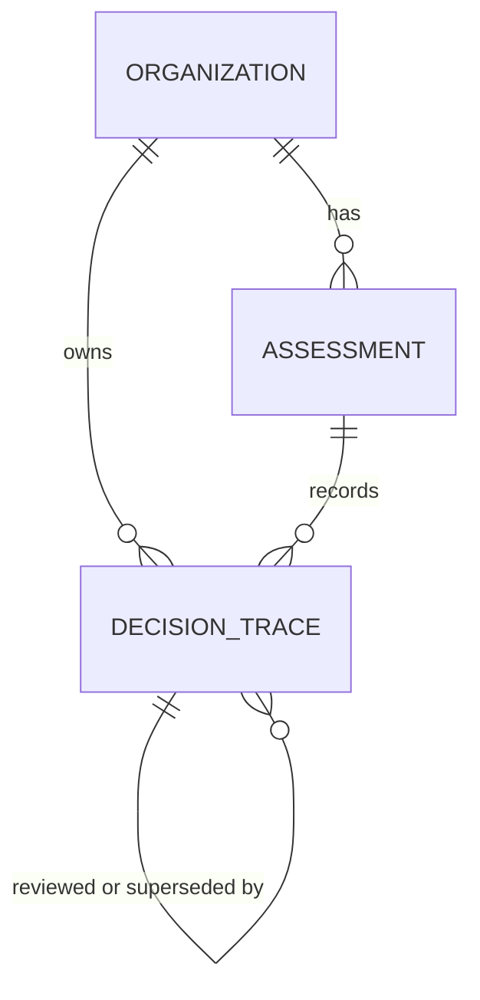

# Reasoning Trace Schema (E0-06)

| Field | Value |
| --- | --- |
| Jira | AGRC-15 (E0-06), AGRC-24 |
| Author | Abedin Orahovac |
| Version | 0.2 (2026-10-10) |
| Status | Draft v0.2, aligned with the agent proof of concept (PR #6). Review by the agent developers (Natalia, Juan) |

## 1. Purpose

The reasoning trace is an **auditable record of every decision** that affects the result of an assessment. It lets a consultant, administrator or auditor reconstruct how each finding was produced: which sources were used, which rule or prompt was applied, what was decided, with what confidence, and who reviewed it.

It is **not** the model's private chain-of-thought, the chat transcript, or technical application logs.

## 2. Principles

1. **One record per decision.** A decision is anything a consultant or auditor could ask "why is this so?" about.
2. **Append-only.** Records are never updated, deleted or truncated (enforced by database triggers). A changed decision creates a new record that points to the old one (`supersedes_trace_id`).
3. **Every agent decision cites at least one source.** An uncited assertion is a fabrication.
4. **Isolated by organization** at the data layer, like all other assessment data.
5. **Persists after the assessment session closes.**

## 3. Decision types

| decision_type | Meaning |
| --- | --- |
| `answer_interpreted` | A fact was derived from an interview answer |
| `evidence_requested` | The agent asked the participant for evidence (an artifact, a screenshot, a configuration export) |
| `evidence_extracted` | Evidence was extracted from a document or Microsoft 365 configuration |
| `evidence_validated` | Evidence was judged `provided_sufficient`, `provided_insufficient`, `documented_absence` or `not_requested` |
| `mapping_assigned` | Evidence or a finding was mapped to one or more NIST CSF 2.0 subcategories, with a justification |
| `status_assessed` | A control status was set. `output.status` is one of `implemented`, `partially_implemented`, `not_implemented`, `not_applicable`, `not_assessed` (the reason is in `rationale`) |
| `maturity_assessed` | A maturity level was set for a subcategory: current and target, 1 Performed to 5 Optimizing (industry convention, not defined by NIST) |
| `contradiction_detected` | Two sources disagree (for example policy vs. tenant configuration) |
| `finding_generated` | A finding (gap) was created, with priority and risks |
| `human_review` | A person accepted, modified or rejected an earlier decision |

Rules that follow from Aligo's evidence rubric and classification guide:

- Evidence judged `provided_insufficient` always sets `requires_human_review = true`, because insufficient evidence and non-compliance are different findings.
- Control status values are written in snake_case exactly as listed above, by the agent, the backend and the export. Reports may show them as Aligo labels (Implemented, Partially, Not Implemented, Not applicable, Not assessed).
- `not_applicable` requires a written justification from the participant (HU-08); without one the control is closed as `not_assessed`.
- `not_assessed` is a recorded decision, not a missing value: partial completeness is normal, and the report must state which subcategories could not be assessed and why.
- Control status, maturity level and remediation status are separate scales and are never derived from each other.

## 4. Fields

### A. Where and when
| Field | Type | Required | Description |
| --- | --- | --- | --- |
| `id` | UUID | yes | Record identifier |
| `organization_id` | UUID → organization | yes | Tenant isolation |
| `assessment_id` | UUID → assessment | yes | Assessment session |
| `created_at` | timestamp with time zone | yes | When the decision was made |

### B. What was decided
| Field | Type | Required | Description |
| --- | --- | --- | --- |
| `decision_type` | enum (section 3) | yes | Kind of decision |
| `control_ids` | text[] | no | NIST CSF 2.0 subcategory codes, e.g. `{PR.AA-03}`; several allowed (many-to-many mapping) |
| `module` | text | no | Interview module, e.g. `Access` |

### C. Based on what
| Field | Type | Required | Description |
| --- | --- | --- | --- |
| `sources` | JSON array | yes for agent decisions | Each item: `type` (`interview_turn`, `document_span`, `tenant_configuration`, `prior_phase_evidence`), `ref`, `excerpt` |
| `evidence_nature` | enum: `intent`, `implementation`, `attestation` | no | Policy (intent), configuration (implementation) or a person's statement (attestation). A policy never proves implementation. Decisions based only on interview answers (`answer_interpreted`, and `status_assessed` from the interview) should use `attestation` |

### D. Who decided and how
| Field | Type | Required | Description |
| --- | --- | --- | --- |
| `actor_type` | enum: `agent`, `assessed_org_representative`, `aligo_consultant` | yes | The organization confirms facts; the consultant validates judgment |
| `actor_user_id` | UUID → user | for human actors | Required for human actors, empty for the agent |
| `model_name` | text | for LLM decisions | LLM used. Empty when the decision was made by a deterministic rule (`prompt_id` starts with `rule:`) |
| `prompt_id`, `prompt_version` | text | for agent | Prompt or deterministic rule applied (a rule uses the prefix `rule:`, e.g. `rule:risk-classification`) |
| `kb_version` | text | yes | Knowledge base version used |

### E. Result
| Field | Type | Required | Description |
| --- | --- | --- | --- |
| `output` | JSON | yes | Decision result, shape depends on `decision_type`, e.g. `{"status": "partially_implemented"}` |
| `rationale` | text | yes | Short human-readable justification that cites the sources |
| `confidence` | number 0–1 | no | Agent confidence; empty for human decisions |
| `requires_human_review` | boolean | yes | True for uncertain or critical decisions |
| `latency_ms` | integer ≥ 0 | no | Time the LLM call took, for the 10 s turn NFR and the model benchmark (E0-04) |
| `fallback_used` | boolean | yes, default false | True when the LLM failed or timed out and a deterministic fallback was used. A fallback interpretation that only leads to a follow-up question does not need review; a control closed (`status_assessed`) on a fallback must set `requires_human_review` |

### F. Review and history
| Field | Type | Required | Description |
| --- | --- | --- | --- |
| `reviews_trace_id` | UUID → decision_trace | for `human_review` | The decision being reviewed. Must belong to the same organization and assessment |
| `review_outcome` | enum: `accepted`, `modified`, `rejected` | for `human_review` | Outcome of the review |
| `supersedes_trace_id` | UUID → decision_trace | no | Earlier decision this record replaces. Must belong to the same organization and assessment |

When `review_outcome` is `modified`, the corrected result is stored in the `output` of the `human_review` record. A review is always made by a person, never by the agent.

## 5. Relationships



The trace references the existing `organizations` table. The `assessments` table does not exist yet, so `assessment_id` is stored without a foreign key until it does (see section 10).

`control_ids` stores NIST CSF 2.0 codes rather than foreign keys, because codes are stable and readable. They are validated against the knowledge base.

Format of `sources[].ref`:

| Source type | Format |
| --- | --- |
| Interview answer | `interview_turn:<id>` (the agent PoC currently writes `turn:<seq>`; it switches to this format when it moves into the backend) |
| Document | `document_span:<document_id>#page=<n>` |
| Microsoft 365 configuration | `tenant_configuration:<snapshot_id>/<path>` |
| Prior technical phase | `prior_phase_evidence:<id>` |

## 6. Reconstructing the JSON export

Only **effective** records are used: records that are not superseded and not rejected by a review.

| Export field (Aligo schema v0) | Derived from |
| --- | --- |
| `framework_mapping[]` | `mapping_assigned`: `control_ids`, `rationale`, `confidence` |
| `evidence[].state`, `validated_by` | `evidence_validated`, confirmed or changed by `human_review` |
| `sources[]` | `sources` of all records linked to the finding |
| `confidence`, `requires_human_review` | `finding_generated` |
| `review` | `human_review`: `actor_type`, `review_outcome` |
| `contradictions[]` | `contradiction_detected` |

This gives the explainability chain: subcategory → finding → evidence → source.

## 7. Access rules

| Role | Can view and export | Can change |
| --- | --- | --- |
| Organization representative | Nothing (HU-03: the representative answers the interview but does not see the agent's internal traces) | Nothing |
| Organization administrator, Aligo consultant | All traces of their organization's assessments | Nothing; adds `human_review` records |
| Platform administrator | All traces, for diagnostics | Nothing |

A user who is not a member of the organization gets `404`, so the API does not reveal whether the organization exists. Append-only is enforced by a database trigger that rejects `UPDATE` and `DELETE` for every database role. Every query filters by `organization_id`. The export is a JSON file (`GET .../traces/export`) with `schema_version`, `exported_at`, `trace_count` and the traces.

## 8. Example

An agent judges a conditional access policy found in report-only mode:

```json
{
  "decision_type": "evidence_validated",
  "control_ids": ["PR.AA-03"],
  "module": "Access",
  "sources": [
    {
      "type": "tenant_configuration",
      "ref": "tenant_configuration:snap-01/conditionalAccess/require-mfa-admins",
      "excerpt": "state: enabledForReportingButNotEnforced"
    }
  ],
  "evidence_nature": "implementation",
  "actor_type": "agent",
  "model_name": "TBD (E0-04)",
  "prompt_id": "evidence-validation",
  "prompt_version": "0.1",
  "kb_version": "csf2.0-kb-0.1",
  "output": { "state": "provided_insufficient" },
  "rationale": "The policy requiring MFA for admin roles is in report-only mode, so it does not enforce MFA. Report-only policies are insufficient per the evidence rubric.",
  "confidence": 0.9,
  "requires_human_review": true
}
```

## 9. Draft PostgreSQL definition

Subject to the stack decision (E0-04) and the main DB schema (E0-02).

```sql
CREATE TYPE decision_type AS ENUM (
  'answer_interpreted', 'evidence_requested', 'evidence_extracted', 'evidence_validated',
  'mapping_assigned', 'status_assessed', 'contradiction_detected',
  'finding_generated', 'maturity_assessed', 'human_review'
);
CREATE TYPE actor_type AS ENUM ('agent', 'assessed_org_representative', 'aligo_consultant');
CREATE TYPE evidence_nature AS ENUM ('intent', 'implementation', 'attestation');
CREATE TYPE review_outcome AS ENUM ('accepted', 'modified', 'rejected');

CREATE TABLE decision_traces (
  id                    UUID PRIMARY KEY DEFAULT gen_random_uuid(),
  organization_id       UUID NOT NULL REFERENCES organizations(id),
  assessment_id         UUID NOT NULL,  -- foreign key added when the assessments table exists
  created_at            TIMESTAMPTZ NOT NULL DEFAULT clock_timestamp(),  -- keeps order within one transaction
  decision_type         decision_type NOT NULL,
  control_ids           TEXT[] NOT NULL DEFAULT '{}',
  module                TEXT,
  sources               JSONB NOT NULL DEFAULT '[]',
  evidence_nature       evidence_nature,
  actor_type            actor_type NOT NULL,
  actor_user_id         UUID REFERENCES users(id),
  model_name            TEXT,
  prompt_id             TEXT,
  prompt_version        TEXT,
  kb_version            TEXT NOT NULL,
  output                JSONB NOT NULL,
  rationale             TEXT NOT NULL,
  confidence            NUMERIC(3,2) CHECK (confidence BETWEEN 0 AND 1),
  requires_human_review BOOLEAN NOT NULL DEFAULT false,
  latency_ms            INTEGER CHECK (latency_ms >= 0),
  fallback_used         BOOLEAN NOT NULL DEFAULT false,
  reviews_trace_id      UUID,
  review_outcome        review_outcome,
  supersedes_trace_id   UUID,

  -- a review or a replacement must point to a trace of the same organization and assessment
  UNIQUE (organization_id, assessment_id, id),
  FOREIGN KEY (organization_id, assessment_id, reviews_trace_id)
    REFERENCES decision_traces (organization_id, assessment_id, id),
  FOREIGN KEY (organization_id, assessment_id, supersedes_trace_id)
    REFERENCES decision_traces (organization_id, assessment_id, id),
  -- sources must always be a JSON array
  CHECK (jsonb_typeof(sources) = 'array'),
  -- agent decisions must record the prompt or rule applied, and cite at least one source
  CHECK (actor_type <> 'agent'
         OR (prompt_id IS NOT NULL AND prompt_version IS NOT NULL
             AND jsonb_array_length(sources) >= 1)),
  -- LLM decisions must record the model; rule decisions (prompt_id 'rule:...') need not
  CHECK (actor_type <> 'agent' OR prompt_id LIKE 'rule:%' OR model_name IS NOT NULL),
  -- a review must say what it reviews and its outcome
  CHECK (decision_type <> 'human_review'
         OR (reviews_trace_id IS NOT NULL AND review_outcome IS NOT NULL)),
  -- a review must be done by a person, never by the agent
  CHECK (decision_type <> 'human_review' OR actor_type <> 'agent'),
  -- a human decision records who made it; an agent decision has no user
  CHECK ((actor_type = 'agent') = (actor_user_id IS NULL))
);

CREATE INDEX idx_trace_org_assessment ON decision_traces (organization_id, assessment_id, created_at);
CREATE INDEX idx_trace_controls ON decision_traces USING GIN (control_ids);
```

## 10. Open questions

1. **Retention:** how long traces are kept after an assessment closes. Decision gate before real data is processed.
2. **Redaction:** whether `excerpt` must be shortened or masked for sensitive data. Decision gate before real data is processed.
3. Resolved: organization representatives do not see traces (HU-03, section 7).
4. How the agent computes `confidence` (agent developers).
5. Add the foreign key on `assessment_id` once the `assessments` table exists. Enforce that the assessment belongs to the same organization with a composite foreign key `(organization_id, assessment_id)` → `assessments(organization_id, id)`.
6. Normalizing `sources` and `control_ids` into separate tables (as in the team schema v0.3) is deferred until the tables they would reference (`interview_turns`, `document_chunks`, `configuration_items`, `framework_nodes`) exist. Until then they stay as JSONB and `TEXT[]` columns.
7. Agent integration: the backend `DecisionTrace` model is the single source of truth. When the agent moves into the backend, it replaces its JSONL `TraceRecorder` with the backend's `record_trace()` function. `record_trace()` only flushes; the caller commits, so a decision and the data it explains (for example an expert review) are saved in one transaction.

## 11. Changelog

| Version | Date | Change |
| --- | --- | --- |
| 0.1 | 2026-09-30 | First draft |
| 0.2 | 2026-10-12 | Human decisions must record `actor_user_id` (agent decisions must not); `TRUNCATE` is blocked like `UPDATE` and `DELETE`. |
| 0.2 | 2026-10-12 | Review by Miloš: reviews and replacements must reference a trace of the same organization and assessment (composite foreign keys); `record_trace()` leaves the commit to the caller. |
| 0.2 | 2026-10-12 | Review by Natalia: control status values listed in snake_case, `not_applicable` added, fallback review required only when a control is closed, `attestation` recommended for interview-based decisions. |
| 0.2 | 2026-10-10 | Access rules aligned with HU-03 (representatives have no access), append-only enforced by trigger, JSON export, `created_at` uses `clock_timestamp()`. Aligned with the agent PoC (PR #6): added `evidence_requested`, `latency_ms` and `fallback_used`; `model_name` required only for LLM decisions; table renamed to `decision_traces` to match the existing plural table names; `assessment_id` without a foreign key until the `assessments` table exists |